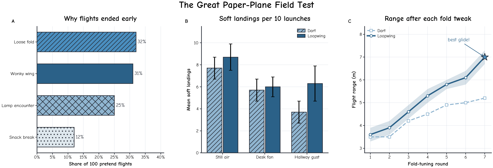
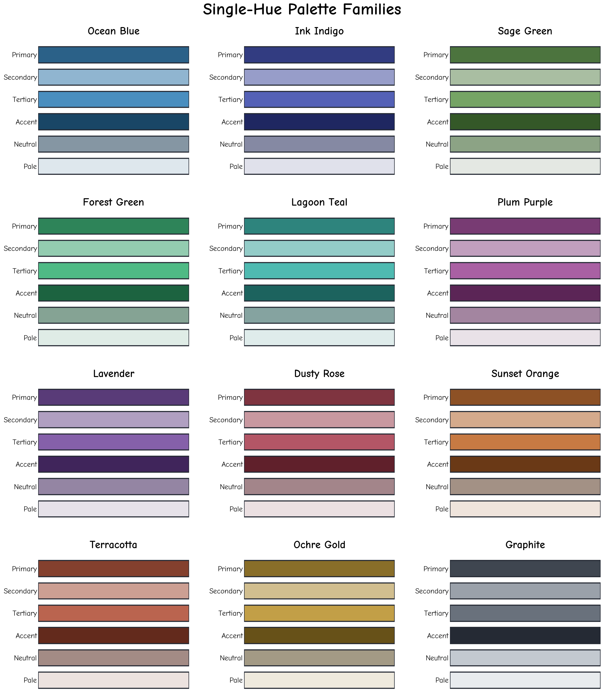

<div align="center">

# FigureInk

**面向科研图表的 Codex Skill：忠实呈现数据，并提供手写风格视觉效果**

[English](README.md) | [简体中文](README.zh-CN.md)




</div>

## 项目简介

FigureInk 是一个兼容 Codex 的 Skill，同时提供基于 Matplotlib 的确定性渲染器，
用于根据经过核对的结构化数据生成具有手写字体风格的科研图表。项目适用于希望
图表具有明确视觉特色，同时需要保持数值准确、可编辑和可复现的论文场景。

渲染器读取 JSON 规格文件，在绘图前检查数据和视觉参数，并导出适合论文使用的
矢量与位图文件。柱形、折线、缺失区间、不确定性范围、标签及高亮点均直接对应
规格文件中声明的数据。


## 主要功能

| 功能 | 说明 |
|---|---|
| **忠实呈现数据** | 所有视觉元素均由声明的数据直接生成；渲染器不会推测缺失测量，也不会自动缩放百分比。 |
| **支持多类图表** | 支持水平柱状图、分组柱状图、折线图及多面板组合。 |
| **同色系配色系统** | 提供 12 组配色，每组通过同一色系内不同明度和饱和度表达不同语义角色。 |
| **面向论文的导出格式** | 每次渲染可生成可编辑 PDF、SVG、300 dpi PNG 及灰度预览图。 |
| **绘图前校验** | 在导出前检查长度、边界、颜色、不确定性数值、引用关系、坐标轴及样式选项。 |
| **可复现记录** | Manifest 记录输入与渲染器哈希、运行环境版本、配色选择、尺寸及产物哈希。 |
| **可移植字体** | 项目内置采用 SIL Open Font License 的 Comic Neue Regular 与 Bold 字体。 |

## 合成数据展示

上方展示图完全由合成数据生成，不包含论文结果、基准测试指标或真实实验测量。
该示例包括：

- 100 次模拟纸飞机飞行结果；
- 三种条件下重复生成的模拟着陆实验；
- 两条带有不确定性区间的合成飞行距离曲线。

生成器使用固定随机种子 `20260804`，因此下面的命令每次都会得到相同的 JSON
规格文件：

```bash
python3 showcase/generate_synthetic_showcase.py
```

如需生成另一组合成示例，可以指定不同的随机种子：

```bash
python3 showcase/generate_synthetic_showcase.py --seed 42
```

展示图的三个面板统一采用蓝色系配色，所有折线均使用直线几何样式
（`"sketch": "none"`）。

## 配色系统



每套配色包含六个语义角色：`primary`、`secondary`、`tertiary`、`accent`、
`neutral` 和 `pale`。各角色通过同一色系内的明度和饱和度差异进行区分。
当图表需要在灰度打印中保持可辨识性时，还可以结合不同标记、线型和填充纹理。

| 配色名称 | 建议用途 |
|---|---|
| `ocean-blue` | 通用科研图表和方法对比 |
| `ink-indigo` | 正式的主要结果汇总 |
| `sage-green` | 人工评估和定性分析 |
| `forest-green` | 系统、效率和鲁棒性结果 |
| `lagoon-teal` | 通用对比和多面板图表 |
| `plum-purple` | 多模态和跨领域结果 |
| `lavender` | 补充实验或探索性分析 |
| `dusty-rose` | 偏好研究和类别分析 |
| `sunset-orange` | 研究动机和问题分析 |
| `terracotta` | 错误与失败案例分析 |
| `ochre-gold` | 重点结果和效率对比 |
| `graphite` | 黑白打印和单色输出 |

对于大多数图表，建议选择一套配色，并在所有面板中保持语义角色一致。

## 安装

### 通过 Codex 安装

在 Codex 中打开本仓库，或在 Codex 任务中提供 GitHub 地址，然后输入：

```text
请从 https://github.com/yzbcs/FigureInk 安装开源的 FigureInk Codex Skill。
Skill 位于 skill/plot-handdrawn-paper-charts。请安装它的 Python 依赖，
将 Skill 复制到我的 Codex skills 目录，校验仓库内置的规格文件，并执行一次
实际渲染以确认安装成功。
```

### 手动安装

```bash
git clone https://github.com/yzbcs/FigureInk.git
cd FigureInk

python3 -m pip install -r skill/plot-handdrawn-paper-charts/requirements.txt

SKILLS_DIR="${CODEX_HOME:-$HOME/.codex}/skills"
mkdir -p "$SKILLS_DIR"
cp -R skill/plot-handdrawn-paper-charts "$SKILLS_DIR/"
```

## 使用方法

### 在 Codex 中调用 Skill（生成的图表可自由组合，并非只能1x3，2x2，1x2等图标组合形式一样很完美。在prompt中和你的智能体积极地表达你想要的想法即可！）

```text
使用 $plot-handdrawn-paper-charts 将这些已经核对的结果绘制成双栏科研折线图/柱状图。
整张图使用一套适合打印的同色系配色，使用直线样式，并输出置信区间、
灰度检查图和可复现 Manifest。
```

### 直接运行渲染器

```bash
SKILL_DIR="$PWD/skill/plot-handdrawn-paper-charts"
SPEC="$SKILL_DIR/assets/example_showcase.json"

# 只校验规格文件，不创建产物。
python3 "$SKILL_DIR/scripts/render_chart.py" \
  --spec "$SPEC" \
  --validate-only

# 渲染完整产物。
python3 "$SKILL_DIR/scripts/render_chart.py" \
  --spec "$SPEC" \
  --output-dir "$PWD/rendered"

# 查看可用配色列表。
python3 "$SKILL_DIR/scripts/render_chart.py" --list-palettes
```

## 规格文件示例

```json
{
  "data_status": "synthetic tutorial fixture",
  "figure": {
    "stem": "paper_plane_range",
    "size": "single-column",
    "palette": "ink-indigo",
    "sketch": "none",
    "dpi": 300
  },
  "panels": [
    {
      "type": "line",
      "x": [1, 2, 3, 4],
      "x_label": "Fold-tuning round",
      "y_label": "Flight range (m)",
      "series": [
        {
          "name": "Dart",
          "values": [3.2, 3.6, 4.1, 4.5],
          "color_role": "neutral"
        },
        {
          "name": "Loopwing",
          "values": [3.1, 3.9, 4.8, 5.6],
          "color_role": "primary"
        }
      ]
    }
  ]
}
```

如需表示折线中真实存在的缺失区间，请在 JSON 中使用 `null`。渲染器会保留
该缺口，不会插值或自动补充数据。

## 输出内容

当图表名称为 `paper_plane_range` 时，一次标准渲染会生成：

```text
paper_plane_range.pdf
paper_plane_range.svg
paper_plane_range.png
paper_plane_range.gray.png
paper_plane_range.source.json
paper_plane_range.manifest.json
```

PDF 和 SVG 适合用于论文编辑与提交；PNG 适合视觉检查或仅支持位图的工作流；
灰度 PNG 用于检查打印可读性；解析后的源 JSON 与 Manifest 则用于记录数据、
配置、运行环境和生成产物。

## 校验与可复现性

在写入任何输出文件前，渲染器会检查：

- 类别和序列长度是否一致；
- 误差数值是否非负；
- 上下界顺序是否正确，并包含对应的有限估计值；
- 高亮点是否指向存在且非空的数据；
- 颜色和配色角色是否有效；
- 坐标轴范围、刻度、标签、尺寸和 DPI 是否一致；
- 请求的样式选项是否受支持。

导出文件会先写入临时目录，然后重新打开、检查并计算哈希，最后作为一个完整
产物集合移动到指定目录。校验失败不会留下不完整产物。在相同且有记录的运行
环境中，重复渲染得到的文件字节一致。

## 样式建议

- 使用 `"sketch": "none"` 获得直线几何效果，适合较小的论文终稿图。
- 使用 `"sketch": "subtle"` 添加克制的手绘路径效果。
- 仅在海报或明确需要非正式效果时使用 `"sketch": "rough"`。
- 除非颜色具有明确的跨色系语义，否则整张图只使用一套配色。
- 在不同面板中保持颜色语义角色一致。
- 需要兼容灰度打印时，应同时使用标记、线型或填充纹理进行区分。
- 柱状图的数值标签应放在填充区域外侧。
- 论文图表应以 PDF 或 SVG 作为主要版本。

## 仓库结构

```text
.
├── README.md
├── README.zh-CN.md
├── LICENSE
├── THIRD_PARTY_NOTICES.md
├── skill/
│   └── plot-handdrawn-paper-charts/
│       ├── SKILL.md
│       ├── LICENSE
│       ├── agents/openai.yaml
│       ├── assets/
│       │   ├── example_showcase.json
│       │   ├── example_palette_gallery.json
│       │   └── fonts/
│       ├── references/
│       ├── requirements.txt
│       └── scripts/render_chart.py
└── showcase/
    ├── generate_synthetic_showcase.py
    ├── hero/
    └── palettes/
```

## 持续集成

GitHub Actions 工作流会在每次推送和 Pull Request 时运行。它使用 Python 3.9
和 3.12 编译渲染器、校验两份内置规格文件，并执行一次真实的冒烟渲染。该工作流
只负责验证仓库，不会发布版本或修改源文件。

## 详细文档

- [图表规格说明](skill/plot-handdrawn-paper-charts/references/chart-spec.md)
- [配色系统](skill/plot-handdrawn-paper-charts/references/color-system.md)
- [论文图表质量检查清单](skill/plot-handdrawn-paper-charts/references/publication-qa.md)

## 许可证

项目代码和文档采用 [MIT License](LICENSE)。项目内置的 Comic Neue 字体采用
SIL Open Font License 1.1，详见
[`assets/fonts/OFL.txt`](skill/plot-handdrawn-paper-charts/assets/fonts/OFL.txt)
和 [THIRD_PARTY_NOTICES.md](THIRD_PARTY_NOTICES.md)。
